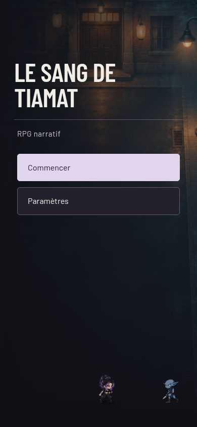
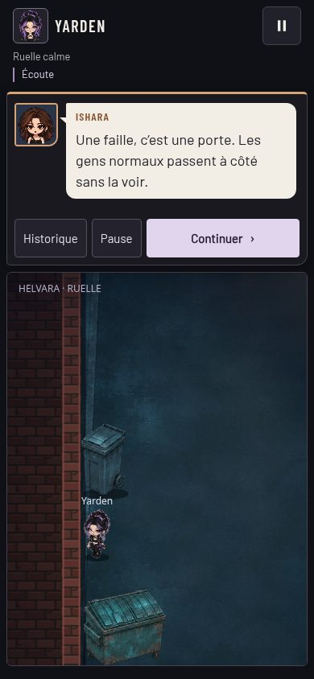
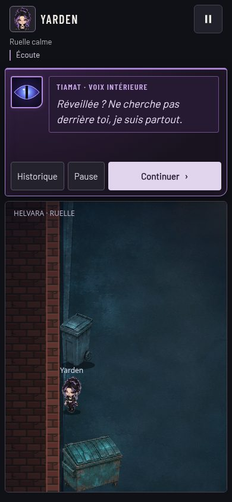
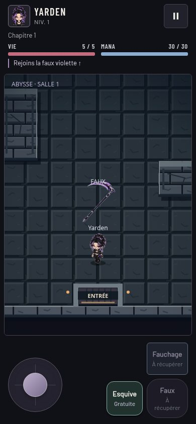

# Une interface plus proche du manhwa

Proposition du 4 novembre 2026, fusionnée depuis **`codex/polish-interface`**.
Retouches du 5 novembre sur **`codex/polish-ajustements`**, depuis `6dd56e0`.
Les chapitres et leurs répliques ne sont pas modifiés.

## Ce qui change, simplement

| Avant | Maintenant | Pourquoi |
|---|---|---|
| Presque tout était violet et arrondi. | Fond encre, bordures fines, angles plus nets. | Les éléments importants ressortent mieux. |
| Les titres ressemblaient à ceux d’un livre classique. | Titres et noms en Barlow Condensed. Texte en Barlow. | Une allure plus proche des lettrages de bande dessinée, sans fatiguer la lecture. |
| Toutes les paroles avaient presque la même apparence. | Bulles ivoire, petite pointe vers le portrait et couleur propre au personnage. | On reconnaît plus vite qui parle. |
| Tiamat avait surtout une bulle violette. | Bulle sombre, œil entouré d’un halo lent et nom violet. | Sa voix se distingue immédiatement des échanges ordinaires. |
| L’écran d’accueil était presque vide. | Le décor de la ruelle accompagne un grand titre et des boutons mieux hiérarchisés. | L’ambiance du jeu est présente dès l’ouverture. |
| Les fenêtres utilisaient plusieurs styles. | Titres, boutons, sac, statistiques, carte et historique harmonisés. | Naviguer demande moins d’effort. |

Les couleurs sont des repères de lecture, pas des indices sur les pouvoirs :

| Personnage | Repère |
|---|---|
| Yarden | Lavande grisée |
| Ishara / Inconnue | Cuivré |
| Céleste | Vert sauge |
| Izzy | Rose bordeaux |
| Félix / Le 4B | Ocre |
| Rémi | Vert olive |
| Tiamat | Violet |
| Autres voix | Sable, avec silhouette sépia si le portrait manque |

Le nom reste écrit : il n’est pas nécessaire de reconnaître les couleurs.
Le sous-titre d’accueil indique simplement « RPG narratif » : aucun nombre de
chapitres à mettre à jour lors des prochaines livraisons.
**« TIAMAT, PAR YARDEN » reste distinct de « TIAMAT · VOIX INTÉRIEURE ».**
Le halo ne fait pas trembler le texte et s’arrête avec le réglage système « réduire les animations ».

## Aperçus sur téléphone

Captures de contrôle à 390 × 844 pixels. Les captures d’Ishara et du chef montrent
leurs bulles avec des répliques existantes ; elles ne représentent pas de nouveaux
échanges ajoutés dans la ruelle.

| Accueil | Dialogue |
|---|---|
|  |  |

| Tiamat | Combat |
|---|---|
|  |  |

[Aperçu de la teinte sable et de la silhouette sépia](interface/voix-neutre.jpg).

## Lecture et petits écrans

La zone de dialogue est un peu plus haute. Les longs paragraphes défilent à
l’intérieur ; les boutons restent accessibles. On peut aussi atteindre le texte
avec Tab et le faire défiler au clavier, sans passer accidentellement à la suite.

En paysage, le dialogue reste à droite du terrain. Une ancienne contrainte de
placement le rabattait à gauche, sur la scène : elle est corrigée ici.

Les deux polices sont incluses dans le jeu, avec leurs licences, pour environ
209 Kio au total. Aucun service de polices ni bibliothèque supplémentaire.
L’écran d’accueil réutilise un décor déjà présent.

## Fichiers concernés

- `polish.css` : couleurs, typographie, bulles et habillage des fenêtres.
- `dialogue.js` : repère du personnage pour la bulle et l’historique.
- `menu.js` : distinction entre accueil, pause et paramètres ; sous-titre à jour.
- `ux.js` : défilement du dialogue au clavier.
- `index.html` : chargement des styles, versions des scripts et accès clavier au texte.
- `assets/fonts/` : les deux polices et leurs licences.
- `README.md`, `docs/JOURNAL.md`, ce document et ses captures : explications.

## Vérifications

- Les **49 scénarios logiques** de `node tests/smoke.cjs` passent.
- Chromium : accueil, paramètres, narration, bulles, Tiamat, historique, combat,
  carte, sac et statistiques à 360 × 640, 390 × 844, 844 × 390 et 1440 × 900.
- Lecture à 18 et 24 px : fin des longs textes accessible, boutons visibles et
  panneau séparé du terrain.
- Contrôles complémentaires : 320 × 568, rotation, clavier, animations réduites,
  affichage avec les polices indisponibles.
- Les fichiers de musique restent absents comme avant ; le jeu utilise sa
  musique générée en secours. Pas de nouvelle erreur JavaScript pendant les essais.

Il reste à apprécier le confort et la fluidité sur un vrai téléphone Android.

## Comment essayer sur téléphone

**La branche ne change pas le site GitHub Pages habituel**, qui publie `main`.
Les captures ci-dessus sont consultables immédiatement sur GitHub.

Pour jouer avant de fusionner : télécharger le ZIP de cette branche, le
décompresser sur un ordinateur et lancer dans le dossier du jeu :

```sh
python3 -m http.server 8000 --bind 0.0.0.0
```

Sur le téléphone connecté au même Wi-Fi, ouvrir
`http://ADRESSE-IP-LOCALE-DE-L-ORDINATEUR:8000` (remplacer le texte en majuscules
par l’adresse locale de l’ordinateur). Arrêter le serveur avec Ctrl+C après le test.
Cette adresse utilise une sauvegarde distincte de celle du site habituel.

Commencer une partie, lire les premières lignes de Tiamat, ouvrir l’historique,
puis Pause → Paramètres et mettre le texte à 24 px. Tourner le téléphone :
la scène et le dialogue doivent rester séparés, et « Continuer » accessible.

Après une éventuelle fusion décidée par Jordan, les mêmes vérifications se font
sur le lien habituel du jeu, après actualisation.
