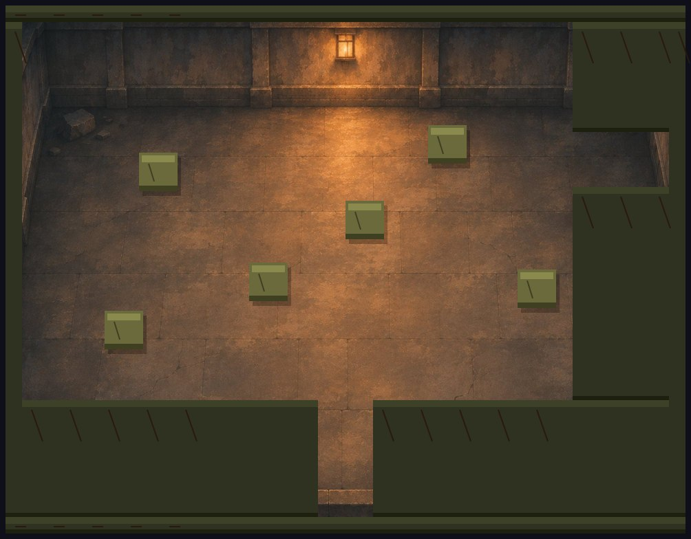
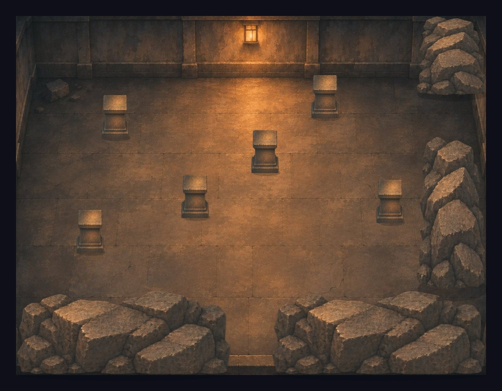
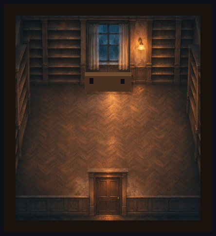
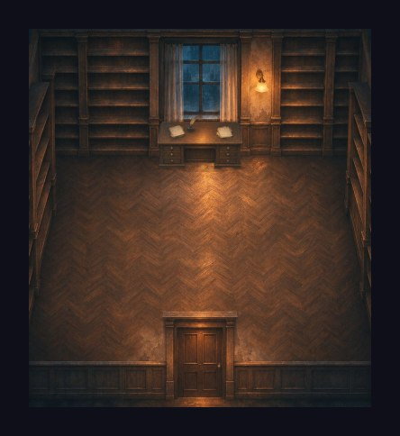
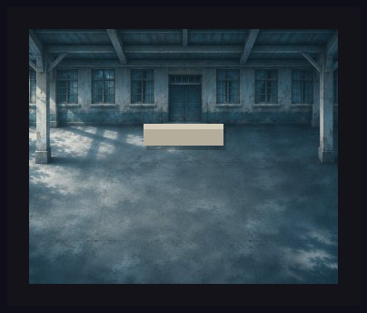
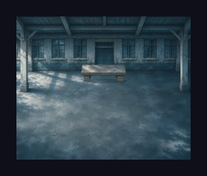
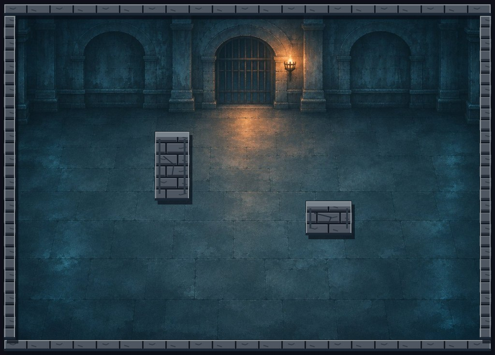
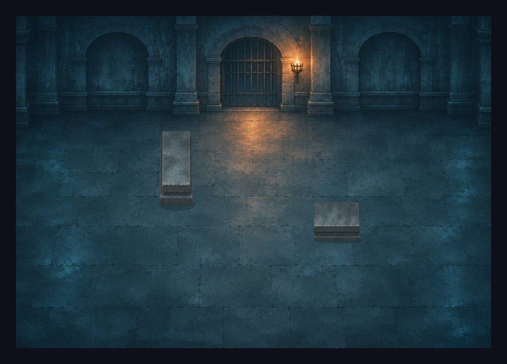
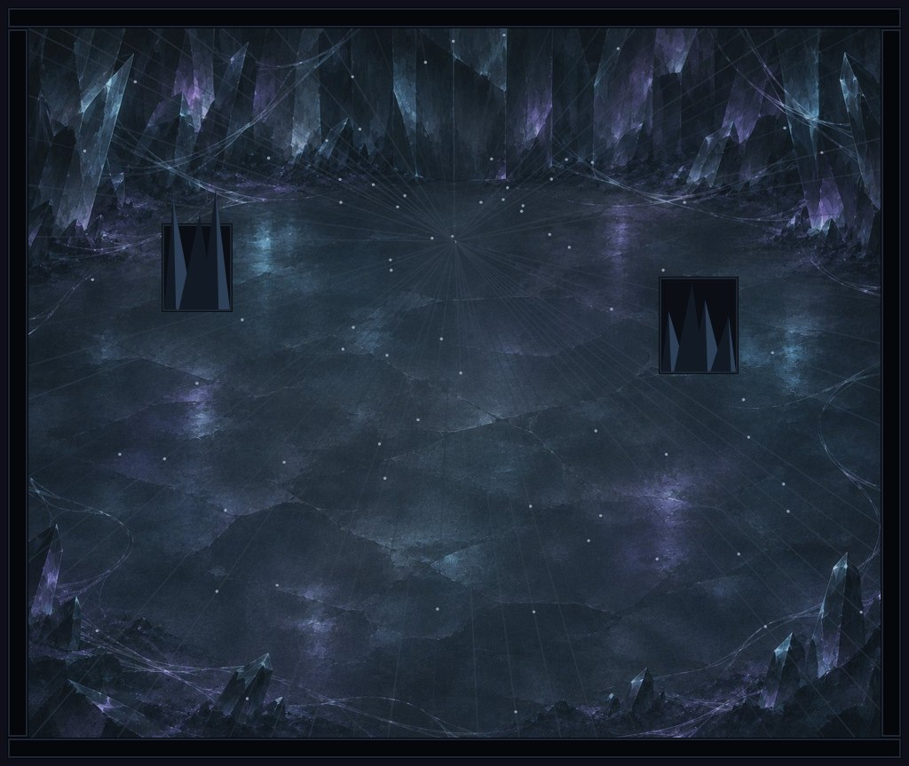
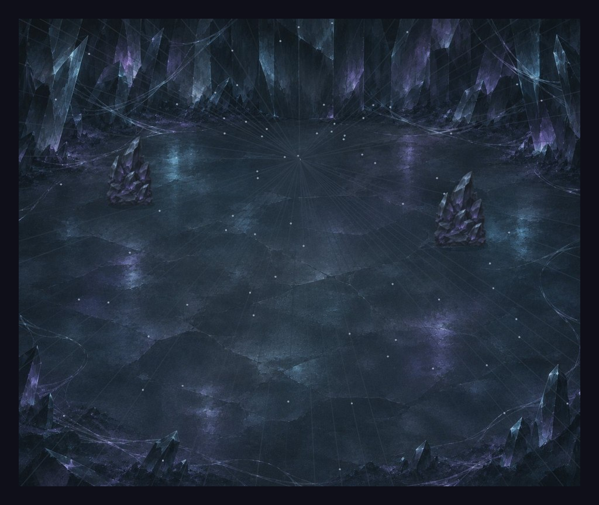

# Les objets manquants des décors

5 novembre 2026 · Branche `codex/raccords-decors` · À relire avant fusion.

Les nouveaux fonds étaient détaillés, mais certains objets posés dessus étaient encore de simples formes dessinées en code. C'est pour cela que les gros rochers verts ressortaient autant dans la salle ocre.

**Les 16 objets concernés ont maintenant des images assorties à leur lieu.** Les passages, les murs qui bloquent Yarden et les points de départ gardent exactement les dimensions de la PR #74.

| Lieu | Ce qui change | Pourquoi |
|---|---|---|
| Salle ocre | Quatre massifs de rochers bruns et six piliers en pierre ocre | Ils reprennent les couleurs du sol et des lampes. Le passage entre les deux rochers du bas reste ouvert. |
| 4B | Bureau en bois, papiers et encrier | Félix a un vrai bureau dans le même style que la pièce. |
| Préau | Banc en pierre usée | Il s'accorde avec la cour et sa lumière froide. |
| Donjon | Deux piliers en pierre bleutée | Ils reprennent la matière des murs, en gardant leurs deux formes différentes. |
| Antre | Deux amas de cristaux sombres, bleus et violets | Ils ressemblent maintenant aux cristaux déjà présents dans l'image. |

Les bandes plates qui entouraient ces cinq fonds sont également masquées : les murs sont déjà peints dans l'image. Leurs collisions restent actives. Si une image ne charge pas, le jeu retrouve son dessin en code.

## Avant / après

Vues complètes du décor, sans les personnages ni l'interface, pour comparer les objets. Cliquer sur une image pour l'agrandir.

| Lieu | Avant — PR #74 | Après — cette branche |
|---|---|---|
| Salle ocre |  |  |
| 4B |  |  |
| Préau |  |  |
| Donjon |  |  |
| Antre |  |  |

Captures dans l'interface au format téléphone : [salle ocre](decors/apres/run-mobile.jpg), [Félix au bureau](decors/apres/quatreb-mobile.jpg), [préau](decors/apres/preau-mobile.jpg), [donjon](decors/apres/donjon-mobile.jpg), [antre](decors/apres/antre-mobile.jpg). Les scènes ont été positionnées pour vérifier le rendu ; ces captures ne constituent pas une partie rejouée entièrement sur téléphone.

## Ce qui est livré

Cette branche part du commit `1454acf` de la [PR #74](https://github.com/Kanoew/Claudex-RPG/pull/74). Elle contient donc déjà les neuf fonds intégrés par Claude, plus les retouches présentées ici. Au moment de la préparation, #74 était encore ouverte. Tu peux fusionner #74 puis cette branche après relecture ; aucun fichier d'image n'est à recopier à la main.

L'escalier, l'appartement d'Ishara et le penthouse restent à reprendre séparément, comme prévu. Les dialogues, les musiques et les scènes du « bloc 2 » ne sont pas modifiés ici.

Fichiers des retouches :

- `assets/decors/objets/raccords.png` : planche transparente commune au bureau, au banc, aux deux pierres du donjon et aux trois objets ocre. La case de cristaux en bas à droite n'est pas utilisée.
- `assets/decors/objets/amas-cristal.png` : cristaux avec une silhouette adaptée à leur emplacement.
- `decors.js` : choix et placement des images, ombres discrètes, suppression du double dessin des bordures.
- `zones.js` : étiquettes visuelles des piliers et cristaux ; aucune coordonnée changée.
- `index.html` : versions des scripts pour que le navigateur recharge les corrections.
- `tests/smoke.cjs` : vérification du placement et du secours si une image manque.
- `PROJECT.md`, `docs/JOURNAL.md`, ce rapport et `docs/decors/` : suivi et captures.

Les deux PNG ajoutent environ 2,5 Mio au chargement initial. Le jeu lit les objets directement dans les images : aucun traitement de pixels n'est effectué à chaque image du jeu. Les fonds existants ne sont pas retouchés.

Pour une prochaine retouche : les rectangles de lecture sont dans `paintedDecor.patches`. Un objet est calé sur la largeur et le bas de sa collision ; `rise` ajoute son relief vers le haut. Les positions de collision sont des coins supérieurs gauches, pas des centres. Conserver ces rectangles si les images sont remplacées, ou mettre à jour les découpes et augmenter la version de leur URL.

## Vérification et essai sur téléphone

- **52 scénarios réussis** avec `node tests/smoke.cjs`.
- Comparaison avec #74 : dimensions des salles, rectangles bloquants, portes et points de départ identiques pour toutes les zones.
- Chromium : cinq lieux contrôlés en portrait 390 × 844, vues complètes capturées, aucune erreur JavaScript. Salle ocre également contrôlée en paysage 844 × 390, avec les images présentes, puis un objet manquant, puis le fond manquant.
- **Pas d'essai sur un vrai Android.** La fluidité et le confort tactile restent à confirmer dessus.

Après fusion et publication du jeu, ouvre ton lien habituel puis actualise la page. Dans la salle ocre, les rochers doivent être bruns et le passage du bas doit rester praticable. Fais le tour des piliers, puis regarde le bureau chez Félix, le banc du préau et les cristaux de l'antre. Une branche GitHub seule ne met pas à jour le jeu public.
