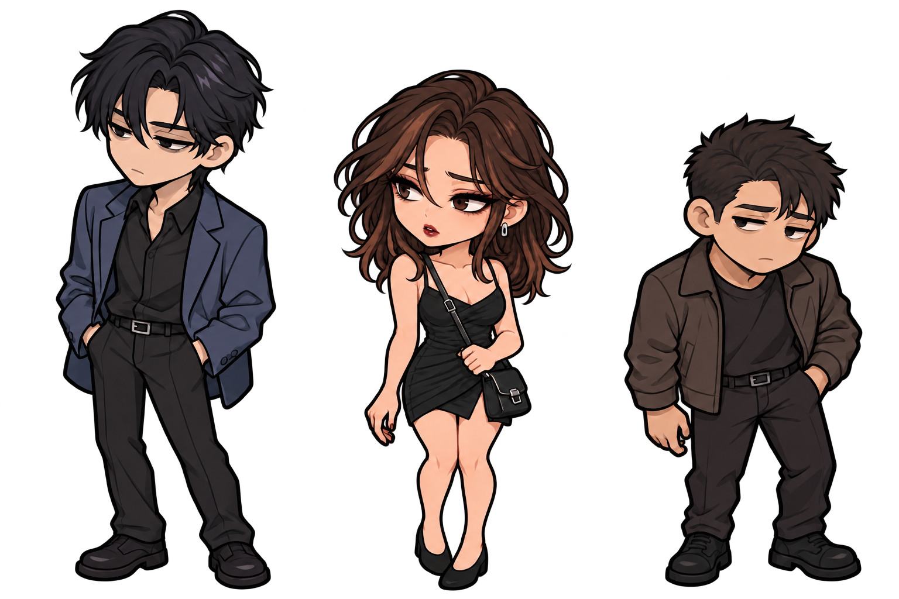

# Rencontre dans la ruelle — proposition de design

Voir la section 11 de `PROJECT.md` pour les précisions de Jordan et les limites entre canon, choix visuels et révélations ultérieures.

La planche de référence présente, de gauche à droite : **le grand**, **Ishara**, **le compact**. Elle sert à valider les personnages avant de préparer leurs animations et de remplacer les silhouettes du jeu. Elle n’est pas chargée pendant une partie.

Ishara reste le centre d’attention : robe noire à bretelles fines, cheveux châtain foncé défaits, boucles argentées, sac compact serré, regard vigilant et maquillage un peu abîmé. La tenue de combat est pour plus tard. Les couleurs d’yeux et les chaussures sont provisoires, faute d’indication dans le lore fourni.

Le physique des hommes est proposé, pas canonisé : grand plus longiligne en veste bleu-gris trop grande ; compact plus ramassé en veste brun-charbon, épaules dans une assurance forcée. Ils restent des hommes ordinaires et secondaires à l’image. Aucun nom, aucune arme, aucune identité ou capacité nouvelle ne leur est attribuée.

À contrôler sur la planche et au futur format de sprite : le mascara sous l’œil **droit anatomique** d’Ishara, les boucles argentées, les bretelles et la diagonale du sac. Un futur retournement horizontal pourrait inverser le détail asymétrique du maquillage ; il faudra choisir les directions de dessin en conséquence.

Écart connu de cet essai : le tour de cou noir visible sur Ishara n’est pas fourni par le lore. Il reste à retirer avant validation ; il ne doit pas être repris dans les sprites comme un détail canonique. Cette planche est une proposition à relire, pas un modèle final approuvé.

Le lieu prévu est un coin de trottoir sous un lampadaire éteint, avec façade aveugle à gauche et grille fermée à droite. Les révélations du chapitre 3 et la bénédiction d’Ishara restent des informations de conception et ne sont pas annoncées par cette illustration de rue.

Jordan demande de laisser le lien Jordan/Yarden de côté pour l’instant : le lore correspondant sera fourni plus tard. Le travail se concentre sur les mouvements réutilisables d’Ishara pour sa présence future dans l’histoire. Les deux passants présents dans le jeu restent inchangés pendant cette préparation, et aucune intervention narrative n’est inventée.

## Mouvements d’Ishara — premier pack

[Ouvrir l’aperçu animé](ishara.html), avec lecture, vitesse réglable, examen image par image et fonds de contrôle. Conserver l’arborescence du dépôt pour une ouverture locale.

Les ressources légères sont dans `assets/npcs/ishara/soiree/` : sept bandes PNG transparentes, quatre images par bande, soit **28 cases de 128 × 160 px**, ancrées en **(64, 140)**. Les bandes totalisent environ **71 Kio** ; elles ne sont pas chargées par le jeu actuel. Le manifeste `animations.json` indique les durées, les rectangles de source et les repères. `animations-data.js` expose les mêmes données à l’aperçu pour fonctionner aussi sans serveur.

| Bande | Usage |
|---|---|
| `idle.png` | Repos, respiration et clignement |
| `walk-left.png`, `walk-right.png` | Marche latérale, deux dessins distincts |
| `walk-up.png` | Marche de dos |
| `walk-down.png` | Marche de face |
| `run-left.png`, `run-right.png` | Course latérale, deux dessins distincts |

Ce pack conserve uniquement la **tenue de soirée**. Le côté gauche du sac est un choix de travail pour assurer sa continuité, pas un nouveau détail du canon. Les sources sont des propositions de poses : contrôler à la taille du jeu la constance du visage, de la robe, du cou, du sac, des pas et du détail sous l’œil droit. Les vues et les cadences restent à valider avant raccordement. Le cou de certaines illustrations doit encore être contrôlé par rapport au tour de cou non canonique de la première référence.

La découpe utilise un grossissement uniforme par bande et une ligne de sol commune ; les courses reprennent le grossissement de la marche correspondante corrigé du format de la source. La pose aérienne de course garde son élévation. Aucun miroir ni recadrage à la taille de chaque silhouette n’est utilisé. Les durées d’aperçu sont provisoires, à synchroniser avec le déplacement futur.

Il n’y a pas encore de course de face ou de dos, de tenue de combat ni de dialogue raccordé. L’organisation par tenue permet d’ajouter ces ressources plus tard sans changer l’identité d’Ishara ni inventer le lien Jordan/Yarden.

Vérifications de préparation : les 28 cases ont les dimensions et marges transparentes prévues ; les deux courses conservent l’élévation de leur pose aérienne. L’aperçu charge les sept bandes dans Chromium sans exception JavaScript ; la lecture, la pause stable et l’avance image par image ont été contrôlées. Cela ne vaut pas validation du dessin ni essai des déplacements sur Android.
