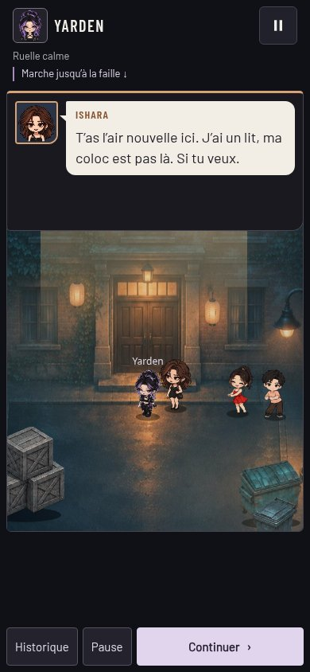
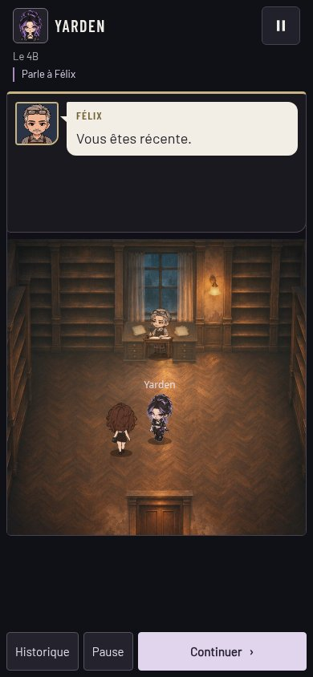
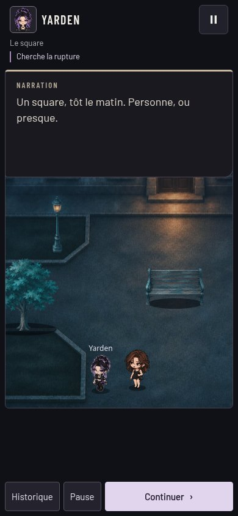
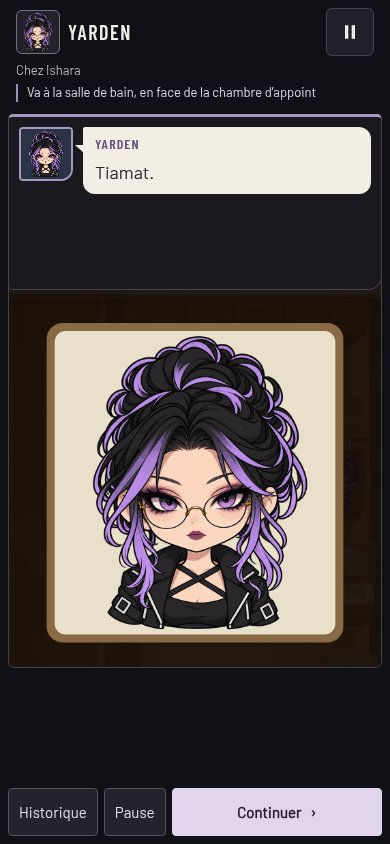

# Voir les personnages pendant les dialogues

6 novembre 2026 · Branche `codex/dialogues-scene-visibles` · Base : `c5c0327` (derniers retours de jeu intégrés par Claude).

Pendant une scène scriptée, le panneau HTML est transparent. Seule la carte portrait/texte a un fond. En portrait, la carte est en haut et mesure 176 px sur un écran de 390 × 844, avec un plafond de 30 % de l'écran. Les longues répliques défilent dans la carte. Continuer, Pause et Historique restent en bas, avec des cibles de 48 px.

La caméra utilise la partie du Canvas libre sous la carte. Les acteurs proches sont cadrés ensemble et les plans de caméra explicites restent prioritaires. Les limites du décor bornent le déplacement ; une petite pièce est centrée dans la zone visible. La mesure tient compte de l'agrandissement du Canvas sur PC et se recalcule à la rotation. L'espace reste stable entre les répliques et les déplacements d'une scène.

Le miroir et le métro se dessinent aussi dans cet espace libre. L'assombrissement volontaire de la nuit reste un effet de la scène, distinct du fond HTML du dialogue. Hors scène scriptée et pendant les étapes d'exploration libre, la disposition habituelle et le cadrage de jeu reprennent.

## Captures en 390 × 844 tactile

Les vraies étapes des scripts ont été avancées jusqu'aux répliques ci-dessous, sans réécrire les textes ni déplacer les acteurs pour les captures.

| Scène | Résultat |
|---|---|
| Fête, invitation d'Ishara |  |
| Chez Félix, « Vous êtes récente » |  |
| Arrivée au square |  |
| Miroir |  |

[Miroir en paysage après rotation](miroir-paysage.jpg).

## Assiette et marche de Yarden

`assets/decors/objets/assiette-oeufs.png` est une image à fond transparent, intégrée au chargeur déjà présent. Sa version d'URL change pour éviter de garder l'ancienne réponse « image absente » en cache. [Assiette dans l'appartement](oeufs.jpg).

Le contrôle a révélé un bug du Jour 2 : les points examinables ajoutés le matin étaient ignorés dans l'appartement. Ils sont maintenant réunis avec les points habituels. L'assiette peut être examinée et la fenêtre, les livres et les autres meubles restent accessibles. Aucune réplique modifiée.

La nouvelle planche `yarden-marche-haut-bas.png` est livrée séparément dans `CLAUDEX-marche-yarden-et-oeufs.zip`, avec une copie de l'assiette. Huit poses sur une ligne : quatre de dos, puis quatre de face. Références : `idle.png` et `running-right.png` du jeu ; gant gauche anatomique conservé après correction de la première proposition. C'est une source à détourer/recaler avant les exports de 96 × 104, ancre (48,101), comme demandé. Les bandes de marche du jeu ne sont pas remplacées à cette étape. Le fond vert peut nécessiter une tolérance au détourage. Les tenues serviette et t-shirt-short restent pour une prochaine validation.

## Vérification et fichiers

- `node tests/smoke.cjs` : **54 scénarios réussis**. Les scénarios existants vérifient aussi le décalage de caméra d'une demi-hauteur de carte, les limites du décor, l'absence de déplacement des acteurs/collisions et le retour au cadrage habituel hors scène. Le parcours de nuit vérifie l'assiette et les autres points examinables du matin.
- Chromium en 390 × 844 tactile : fête, Félix, square et miroir ; carte sans voile, personnages/portrait dégagés, boutons visibles en bas. Réplique longue à 24 px défilable, Historique puis retour, rotation en 844 × 390 et retour portrait, dialogue hors scène avec son fond habituel, apparition de l'assiette et interaction vérifiées. Aucune erreur JavaScript.
- Aucun essai sur un vrai Android.

Code modifié : `scene.js`, `render.js`, `ux.js`, `polish.css`, `mirror.js`, `metro.js`, `apartment.js`, `decors.js` et leurs versions dans `index.html`. Vérifications dans `tests/smoke.cjs` ; images de contrôle dans ce dossier.

Après fusion, actualiser le jeu. À la fête et chez Félix, regarder les personnages pendant les répliques ; essayer une longue réplique et Historique. Tourner le téléphone au miroir, puis revenir en portrait. Au Jour 2, s'approcher de l'assiette au comptoir et choisir Examiner : elle doit être décrite et disparaître du décor.
