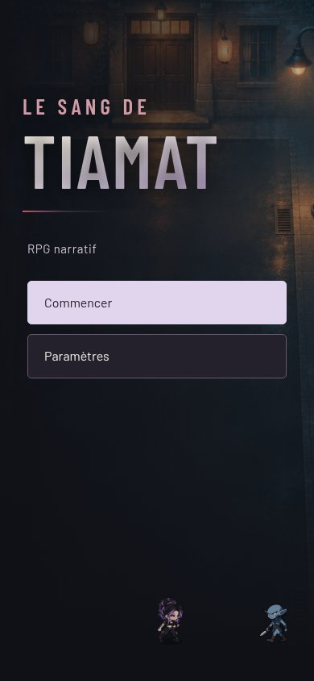

# Titre manhwa de l'accueil

Version retenue par Jordan le 5 novembre 2026 : « Le Sang de » en petit, bordeaux clair, puis « TIAMAT » en grandes lettres avec un dégradé ivoire-lavande et un trait bordeaux sous le titre. Police Barlow Condensed déjà présente dans le jeu.

Autres formats vérifiés : [320 × 568](320x568.jpg), [360 × 640](360x640.jpg), [paysage 844 × 390](844x390.jpg), [PC 1440 × 900](1440x900.jpg).

Fichiers : `menu.js` compose les deux lignes uniquement sur l'accueil ; `polish.css` définit leur apparence et la version compacte en paysage ; `index.html` recharge les versions actualisées. Le titre reste du texte sélectionnable et conserve son nom complet pour les lecteurs d'écran. Paramètres et Pause retrouvent leur titre simple.

Validation : 53 scénarios logiques réussis ; Chromium aux cinq formats, titre et boutons dans l'écran, ouverture de Paramètres, retour à l'accueil et ouverture de Pause sans erreur JavaScript. Aucun essai sur Android réel.

Après fusion, ouvrir le jeu et actualiser : « TIAMAT » doit dominer le titre. Ouvrir Paramètres puis revenir, commencer la partie et ouvrir Pause pour vérifier les autres titres.
